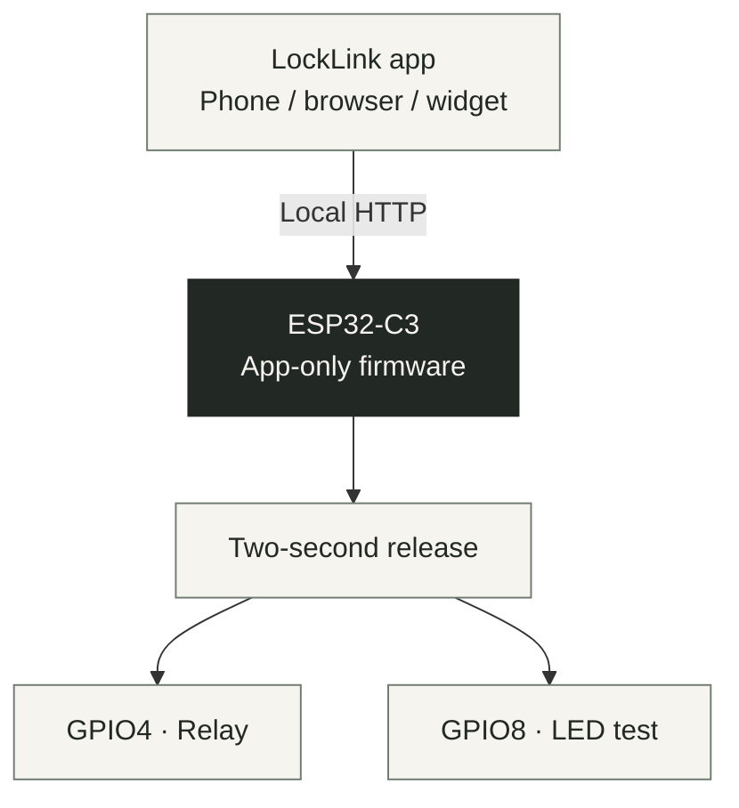

<p align="center">
  
</p>

<h1 align="center">LockLink</h1>

<p align="center">
  Local door control from your phone.<br>
  Flutter + ESP32-C3 on your home Wi-Fi.
</p>

<p align="center">
  <a href="LockLink_App"></a>
  <a href="LockLink_Docs/ESP32_C3_SETUP.md"></a>
</p>

<p align="center">
  <a href="#getting-started">Set up device</a> ·
  <a href="#version-updates">Change version</a> ·
  <a href="#mobile-releases">Build apps</a>
</p>

Current source version: **v2.2.3**.

Intermittent Wi-Fi packet loss is still reproduced on the test board. This
release improves memory and request handling but is not yet validated for
permanent door installation. See the [current investigation](LockLink_Docs/RELIABILITY_2026-10-02.md).

## What LockLink does

| Feature | How it works |
| --- | --- |
| Local control | The app requests a two-second release from the ESP32 on the same network. |
| Connection recovery | Home refreshes on return and retries failed status reads automatically. |
| Diagnostics | Bounded health data; USB-only checks, no retained network log buffer. |
| Gate widgets | Native controls for Android and iPhone; iPhone widgets require a signed installation. |
| App-only firmware | More RAM for local control, bounded requests, and Wi-Fi recovery. |

## How it connects



The reported state describes the release output. There is no door-position
sensor, so it cannot confirm that the physical door opened.

## Getting started

1. Use the **ESP32-C3 Super Mini** and follow the
   [installation guide](LockLink_Docs/ESP32_C3_SETUP.md). Start with the relay
   disconnected and LED test mode.
2. Configure Wi-Fi in the private firmware configuration. Run
   USB `STATUS` to find the device address.
3. Run the Flutter app, save that address in Settings, and use a matching private
   app key for relay control. Read [relay setup](LockLink_Docs/RELAY_SETUP.md)
   before connecting a lock.

<details>
<summary>LED-only setup and test commands</summary>

1. Disconnect the relay. The Super Mini blue LED is GPIO8, active LOW. The
   firmware uses this physical GPIO directly, rather than an RGB LED driver.
2. Copy `LockLink_IoT/include/private_config.example.h` to
   `LockLink_IoT/include/private_config.h` only if it does not exist. Preserve
   existing private values. Set `LOCKLINK_RELAY_ENABLED 0` for this LED test.
   Set `LOCKLINK_WIFI_SSID` and `LOCKLINK_WIFI_PASSWORD` in the private
   config for first installation. Saved networks take priority on updates.
3. In `LockLink_IoT`, run `pio run -e esp32-c3-supermini -t upload`, then
   `pio device monitor -b 115200`. This environment pins pioarduino
   `55.03.312-1` / Arduino-ESP32 `3.3.12` and the existing C3 partition layout.
4. USB `STATUS` reports connectivity and health without printing credentials.
5. Use the reported IPv4 address for
   `curl http://DEVICE_IP/status`. In LED mode only,
   `curl -X POST http://DEVICE_IP/unlock` tests the same pulse.
6. In `LockLink_App`, run `flutter run`, enter the reported device address in
   Settings, and tap **Save device**. Relay control also requires the matching
   private app key; the example firmware key is empty.

</details>

<details>
<summary>Appearance, polling and reconnect behavior</summary>

Settings has Light, Dark, and System appearance modes and a haptic feedback
switch on Android/iOS. These preferences save automatically. System is the
default appearance mode and follows the phone's theme.

The active home screen checks the ESP32's shared release state 500 ms after
each completed status read, with a four-second request timeout. After a failed
read, retries wait one second, then two seconds, then five seconds. Polling pauses in the background and in device settings;
returning refreshes the state immediately. Four foreground phones can share the
same device/key; closed/background apps do not continuously poll it.
It disables Unlock while the device is offline or a pulse is active.
After returning to the app, control waits for a fresh status response. See
[offline behavior and recovery](LockLink_Docs/OFFLINE_BEHAVIOR.md) for power loss,
network changes, unconfirmed commands, widgets and first-time setup.

</details>

## Version updates

`LockLink_App/pubspec.yaml` is the single source for the release version and
build number. For future updates, run one command from the repository root—for
example:

```bash
python .github/scripts/sync_version.py --set 2.2.0+220
```

This synchronizes Settings, firmware, all three iOS widget configurations and
current docs. Use your next version and build number in place of `2.2.0+220`.
If you edit the `version:` field yourself, run
`python .github/scripts/sync_version.py` afterward.

New versions get a draft release-notes file; write the changes and
verification results there, then remove its draft marker. Historical release
notes and dated diagnoses are preserved. CI rejects unsynchronized metadata,
and publication rejects draft notes.

## Mobile releases

Version **2.2.3** sets each accepted release to two seconds. Repeated Unlock
commands during an active release do not extend it. Native Android/iPhone
widgets use the same release duration. The firmware remains app-only.
Both the center circular control and the Unlock button request the same release.
See [v2.2.3 release notes](LockLink_Docs/releases/v2.2.3.md)
for this version's changes and validation boundaries. Older
[v1.5.0 notes](LockLink_Docs/releases/v1.5.0.md) remain historical.

Push this repository to GitHub, then open **Actions → Manual mobile release →
Run workflow**. There is no version input: the workflow reads `pubspec.yaml`,
derives its tag, and checks GitHub before building. If that release already
exists, it stops and tells you to change the source version and synchronize it.
After workflow validation, C3 firmware checks and both mobile builds succeed,
it checks again before creating a new GitHub Release containing
`LockLink-Android.apk` and `LockLink-iOS-unsigned.ipa`.

| Artifact | Use |
| --- | --- |
| `LockLink-Android.apk` | Android installation and testing. |
| `LockLink-iOS-unsigned.ipa` | iPhone build; signing is required before installation. |

The APK uses the Flutter template's test signing configuration and is for
installation/testing, not Play Store distribution. The IPA is **unsigned**;
it cannot be installed on an iPhone until it is signed with an Apple development
or distribution identity. iOS builds require the GitHub macOS runner and cannot
be validated on this Windows checkout.

<details>
<summary>Release checks and public firmware artifacts</summary>

The tag must match the app source version and resolve to the workflow's source
commit if it already exists. README, firmware, app footer, widget versions and
current release notes must agree. Manual release runs are serialized. The macOS
job also runs native widget tests and retains diagnostic logs and test results.
App pushes and pull requests also run **Mobile checks** for version consistency,
Flutter analysis/tests, Android compilation, and native widget tests. Firmware
checks build all four firmware images and run the native behavior suites.
Android workflows use Java 17. **Workflow checks** uses a pinned, checksum-verified
actionlint binary to validate all workflow files. The release reuses those
checks and refuses publication if any required job fails. Public firmware
artifacts are unarmed and exclude private configuration.

</details>

## Widgets

Native gate widgets are available for Android Home Screen and iPhone
Home Screen, Today View, and Lock Screen. See [widget setup](LockLink_Docs/WIDGETS.md)
and the original [v1.4.0 widget release notes](LockLink_Docs/releases/v1.4.0.md). iPhone widgets require
a direct installation with the extension signed; LiveContainer guest installs
cannot expose the widget to iOS.

## Hardware and diagnostics

The current firmware targets the ESP32-C3 Super Mini with 4 MB flash and no
PSRAM. Relay wiring and authentication details are in the
[relay guide](LockLink_Docs/RELAY_SETUP.md).

<details>
<summary>GPIO behavior and private app key setup</summary>

LockLink is a local network door controller for ESP32-C3 Super Mini (4 MB flash,
no PSRAM). GPIO4 is **HIGH at idle and LOW for two seconds**; GPIO8 drives
the onboard active-LOW blue LED. Relay mode is the default, and requires a valid
private app key before any app command can start a release pulse.
Signal polarity does not identify physical coil state: a HIGH-ON relay stays
energized at idle with this inverted configuration. Check the wiring guide.

Read [relay setup](LockLink_Docs/RELAY_SETUP.md) before connecting the lock.
Relay mode is enabled by default and requires a matching private app key.
Generate a private 64-character hexadecimal key for `LOCKLINK_UNLOCK_KEY_HEX`
and enter the same key once in the app. An empty or invalid key leaves relay
mode unarmed. The app accepts a 4–64 character pairing value and derives its signing
key with SHA-256; an existing 64-character hexadecimal key is used directly.
To change a text pairing value manually, put its SHA-256 hex digest into
`LOCKLINK_UNLOCK_KEY_HEX` and the original value into app settings. Unlock then
requests a fresh one-time challenge automatically; there is no code to type
for each use. On Android/iOS the key is stored in platform secure storage.
The web app keeps it only until the tab closes.

The status screen reports whether the ESP32 is online and whether its unlock
output is active. It cannot confirm that the door physically opened; there is
no door-position sensor.

</details>

<details>
<summary>USB diagnostics and firmware updates</summary>

Type `STATUS` and Enter to check firmware version, memory/temperature/Wi-Fi health, the
local IP, and release output. Test `GET /status` for app connectivity.
A single `ESP_ERR_WIFI_CONN` / “sta is connecting”
message during startup means a connection attempt was already in progress;
it does not establish an ongoing failure. Check the later state before
changing configuration. See [recovery guidance](LockLink_Docs/OFFLINE_BEHAVIOR.md)
for persistent connection problems. USB `WIFI RECONNECT` cycles the board's
connection without erasing settings; ordinary firmware updates preserve them.
Use the normal PlatformIO upload for updates. The combined factory image
wipes NVS and is for initial installation or deliberate recovery.

</details>

## Web and remote access

Build the local web client with `flutter build web`. Serve `build/web` on your
local network for browser testing. The browser must be allowed to reach the ESP32;
web requests are subject to CORS and local network permissions.

**Do not use Vercel as a remote unlock route yet.** Vercel can host the Flutter
static files, but it cannot directly reach a private ESP32 on your Wi-Fi. A
public HTTPS page calling a private HTTP address also faces browser mixed-content
and local-network permission restrictions. Relay mode accepts signed local
commands and disables browser access unless the exact local origin is
explicitly allowlisted in private configuration, but it is not a remote-access service. Remote unlock needs a
separate design and security review.

## Guides

| Guide | Start here when you want to… |
| --- | --- |
| [ESP32-C3 setup](LockLink_Docs/ESP32_C3_SETUP.md) | Install firmware or migrate to the C3 board. |
| [Relay setup](LockLink_Docs/RELAY_SETUP.md) | Connect and configure the relay and lock. |
| [Widget setup](LockLink_Docs/WIDGETS.md) | Add native Android or iPhone controls. |
| [Offline recovery](LockLink_Docs/OFFLINE_BEHAVIOR.md) | Diagnose connection, power or network changes. |
| [USB health reference](LockLink_Docs/USB_DIAGNOSTICS.md) | Read diagnostics without an app Terminal. |
| [Current investigation](LockLink_Docs/RELIABILITY_2026-10-02.md) | Read measured results and the remaining packet-loss problem. |

## Repository

| Folder | Contents |
| --- | --- |
| [`LockLink_App/`](LockLink_App/) | Flutter client for Android, iOS and web. |
| [`LockLink_IoT/`](LockLink_IoT/) | ESP32-C3 app-only firmware and local HTTP API. |
| [`LockLink_Docs/`](LockLink_Docs/) | Wiring, setup, diagnostics and release notes. |
